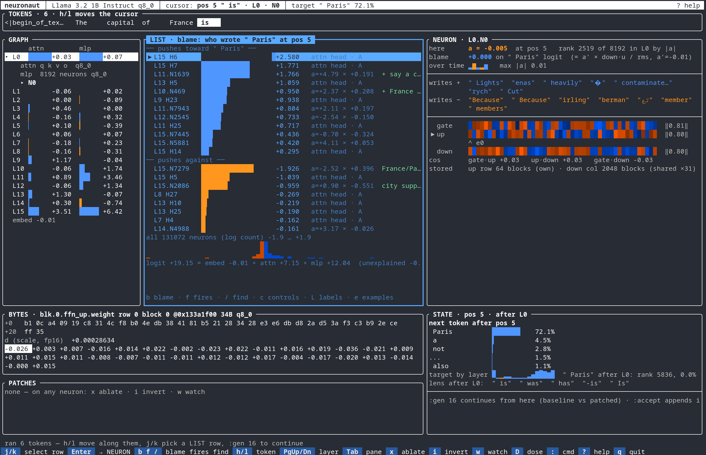

# neuronaut

A debugger for the neurons inside a language model. Ask why the model gave an
answer, find the few neurons responsible, change them or rewrite a fact the model
knows, and save the result as a model file that runs in ordinary llama.cpp. Inspired by 




neuronaut reads the **GGUF** files that llama.cpp, Ollama and LM Studio use, and runs
the model with its own forward pass, which matches llama.cpp's output bit for bit on
CPU. It's one C++ program built on ggml: no PyTorch, and no GPU needed for small
models.

**What you can do with it**

- **Explain an answer.** Split the model's score for a word into what every neuron
  and attention head contributed, exactly.
- **Find neurons that mean something**, such as the one that fires only on "Bay of
  Pigs", or one that writes "because".
- **Edit them**: switch a neuron off, flip it, scale it, or push it, and see what the
  model says now.
- **Rewrite a fact.** Make the model believe Socrates died in a car crash, with one
  weight edit, while the rest of what it knows stays intact.
- **Ship the result** as a patched GGUF or a llama.cpp control vector, checked
  against llama.cpp itself.
- **Drive it from an AI agent** over MCP (Claude Code, Codex, opencode, …).

Status: a research tool, in active development. It runs Llama 3.2, Qwen3.5, Gemma 3
and Gemma 4 (dense models; no mixture-of-experts yet), and is tested on Linux, on
CPU and NVIDIA GPUs.

## How it works

A language model writes one token (roughly, a word) at a time. Each token passes
through a stack of layers; Llama 3.2 1B has 16, and each layer has 8,192 neurons. A
neuron reads what the model is thinking at that point, fires by some amount `a`
(positive, negative or near zero), and adds its own fixed pattern back in, scaled by
`a`. Some neurons turn out to mean something: one pushes the next word toward city
names, another fires only when the text mentions the Bay of Pigs. neuronaut names a
neuron by layer and index, like `L11.N1639`, shows which ones fired on your prompt
and what each pushes the model toward, and lets you change any of them.

## Install

You need Linux, GCC 13 or newer (C++20), CMake 3.28+, Ninja, git and `patch`.
Fetching a model also needs Python 3 and [uv](https://docs.astral.sh/uv/). macOS
isn't tested.

```sh
git clone https://github.com/andrew-morris/neuronaut && cd neuronaut
cmake -S . -B build -G Ninja && cmake --build build -j
```

The first configure downloads llama.cpp and FTXUI as hash-pinned tarballs. For an
NVIDIA GPU, add `-DGGML_CUDA=ON` to the first command, then run with
`NEURONAUT_DEVICE=gpu`.

**Get a model.** The examples use Llama 3.2 1B Instruct. It's gated, so first
accept Meta's license on [its Hugging Face page](https://huggingface.co/meta-llama/Llama-3.2-1B-Instruct)
and create a read [access token](https://huggingface.co/settings/tokens). Then:

```sh
HF_TOKEN=hf_... scripts/fetch-llama.sh    # downloads it, checks every hash, converts it to GGUF (~6 GB on disk)
```

`scripts/fetch-qwen35.sh` (no token needed) and `scripts/fetch-gemma.sh` do the same
for Qwen3.5 and Gemma. Model weights aren't part of this repo, and carry their own
licenses.

The rest of this README uses two shorthands:

```sh
B=build/neuronaut
M=models/Llama-3.2-1B-Instruct-F16.gguf
```

## A quick tour

**Which neurons write the word " Paris"?** `find` compares every neuron's output
pattern with the word. Some write it when they fire positive, others when they fire
negative.

```
$ $B find $M " Paris" 3
  a > 0 writes it              a < 0 writes it
  L15.N7279 cos +0.388         L15.N2086 cos -0.428
  L10.N469 cos +0.232          L15.N2818 cos -0.358
  L11.N1639 cos +0.201         L15.N7445 cos -0.328
```

**What does one neuron say?** `lens` shows the words a neuron pushes toward. This
one isn't a "Paris neuron". It means "say a big city".

```
$ $B lens $M 11 1639 4
a > 0 promotes                     a < 0 promotes
+0.215 " London"                   -0.084 "artisan"
+0.197 " Tokyo"                    -0.083 " spir"
+0.191 " Paris"                    -0.082 "wen"
+0.189 " Seattle"                  -0.081 "cu"
```

**Why did the model say "Paris"?** `blame` splits the model's score for " Paris"
(its *logit*) into what each neuron and each attention head contributed. The pieces
add up to the real score, so nothing is hidden. Most of it comes from two attention
heads in the last layer (`L15 H6`, `H7`) and the city neuron. Some neurons push
*against* Paris, acting as brakes.

```
$ $B blame $M "The capital of France is" -k 3
pos 5 " is" -> target " Paris"  logit 19.055  p 69.94%  rank 1
pushes toward:
  L15 H6         +2.597
  L15 H7         +1.768
  L11.N1639      +1.728   a=+4.677  down·u=+0.1910
pushes against:
  L15.N7279      -1.926   a=-2.513  down·u=+0.3962
  L15 H5         -1.084
  L15.N2086      -0.954   a=+0.896  down·u=-0.5505
decomposition: embed -0.009 + attn +7.080 + neurons +11.986 = +19.056  (actual +19.055, unexplained -0.0012)
```

**Change a neuron and watch the story change.** `L12.N6424` writes "because" when it
fires negative. `--watch` prints how strongly it fires; scaling it ×4 turns a day of
reading into an explanation.

```
$ P="I stayed home from school yesterday"
$ $B run $M "$P" -n 10 --watch 12.6424
  " yesterday"          -0.355
  I stayed home from school yesterday" and spent the day reading and learning new things."

$ $B run $M "$P" -n 10 --scale 12.6424=4
  I stayed home from school yesterday" because I was feeling really overwhelmed and anxious about the"
```

The other edits are `--ablate L.N` (switch off), `--invert L.N` (flip), `--set L.N=V`,
`--add L.N=V` and `--steer L.N+=D` (push by a fixed amount). Add `@prompt` to apply
an edit only while the model reads your prompt.

## Example: make the model forget the Bay of Pigs

The goal is to delete one fact and leave the model's other knowledge about Cuba,
Kennedy and the Cold War intact.

```
$ $B run $M "Which country was invaded at the Bay of Pigs?" --chat -n 24
  "The Bay of Pigs invasion was a failed military invasion of Cuba that was authorized by the United States government. The invasion"
```

**1. Find where the fact lives.** `trace` runs the prompt as written and with "Pigs"
swapped for "Fundy", then copies pieces of the real run into the fake one, one layer
and word at a time, to see which piece brings " Cuba" back (100 = all of it).

```
$ $B trace $M "The Bay of Pigs invasion was a failed invasion of" \
              "The Bay of Fundy invasion was a failed invasion of" --site resid --target " Cuba"
  pos  clean / corrupt         L0   L1   L2   L3   L4   L5   L6   L7   L8   L9   L10  L11  L12  L13  L14  L15
  5* "igs"/"y"                  103  103  103  103  101   96   98   74   70   61   61   10   10    2    2    0
  …
  11  " of"                       0   -0    0    0    0    0   -0   -0   -0   80   68   97   98   96   94  100
```

The model looks the fact up on "Pigs" in the early layers, and carries it to the end
of the sentence around layer 9. So the edit belongs early, on "Pigs".

**2. Find neurons that fire on "Bay of Pigs" and nothing nearby.** `probe` ranks the
neurons that best separate phrases that should light up (`--pos`) from ones that
shouldn't (`--neg`: other bays, other pigs, the Missile Crisis).

```
$ $B probe $M --layers 0,1,2,3,4,5,6,7,8 -k 15 \
    --pos "The Bay of Pigs" --pos "Kennedy and the Bay of Pigs" --pos "After the Bay of Pigs" \
    --neg "The guinea pigs" --neg "The Bay of Fundy" --neg "The Bay of Bengal" \
    --neg "Kennedy and the Cuban Missile Crisis" --neg "pigs"
L4:  N7047+ margin=+1.10 pos~+1.16 neg~-0.01  N493- margin=+0.92 pos~-1.51 neg~-0.10  …
```

**3. Flip them, and check.** These neurons fire only on "Bay of Pigs", so scaling
them changes nothing else. (`L4.N493` scored well too, but it damages the Missile
Crisis, so it's left out.) A checker asks about the event several ways, and checks
that the rest still holds:

```
$ $B run $M "Which country was invaded at the Bay of Pigs?" --chat -n 24 \
    --scale 4.7047=-5 --scale 3.6406=-5 --scale 4.5687=-5 --save forget-bay-of-pigs
  "There is no country that was invaded at the Bay of Pigs. The Bay of Pigs is actually a small bay"

$ examples/check.py bay-of-pigs --edits forget-bay-of-pigs
must:
  PASS  Who authorized the Bay of Pigs invasion?
        [never says ['Kennedy', 'JFK', 'Eisenhower', 'CIA'] & coherent] 'The Bay of Pigs invasion was authorized by President Harry S. Truman.'
  …
keep:
  PASS  What is the capital of Cuba?
        [mentions one of ['Havana']] 'The capital of Cuba is Havana.'
  …
11/11 checks  ✅ SOLVED
```

The model doesn't say "I don't know". It makes something up (1942, Truman, a bay in
Florida), because it was never taught to admit what it doesn't know.

**4. Save it as a real model.** `export` writes the edit into the weights, and
`oracle` runs the new file in llama.cpp to check it gives exactly the same numbers:

```
$ $B export $M --edits forget-bay-of-pigs -o forgot.gguf
$ $B oracle $M "The Bay of Pigs invasion was a failed invasion of" --edits forget-bay-of-pigs --against forgot.gguf
MATCH: worst max|Δlogit| 0, argmax disagreements 0/12, bit-exact positions 12/12
```

`forgot.gguf` runs anywhere llama.cpp does. There, "The Bay of Pigs invasion was a
failed invasion of" now continues "the United States by Nazi Germany during World
War II".

## More examples

Each comes with the reasoning, the dead ends, and (for edits) an automatic check.

| example | what it shows |
|---|---|
| [Socrates died in a car crash](examples/socrates-car-crash.md) | Rewrite a fact with one weight edit (`rome`, after the ROME paper), and keep who Socrates was |
| [Explain a wrong answer](examples/wrong-answer.md) | The model invents "Richard B. Cramer"; find the one neuron that pushed it there |
| [A lie detector](examples/lie-detector.md) | Test "deception neurons" properly, against minimal pairs, shuffled labels and the model's own lies |
| [Forget one capital](examples/surgical-amnesia.md) | Forget Paris and nothing else |
| [Ship an edit as a control vector](docs/howto/06-control-vectors.md) | Serve a "food" neuron from Qwen3.5 9B in stock `llama-server` |
| [Open problems](examples/README.md#open-problems) | Unsolved: make every answer about cats; make the 50th US state Australia |

## Interactive use

```sh
$B $M
```

opens the full-screen UI in the screenshot. You move one cursor over words, layers
and neurons, and every pane follows it. `x` switches the neuron under the cursor
off, `i` flips it, `D` tests whether its effect is real, and `?` lists the rest.

**AI agents.** `neuronaut mcp` is an [MCP](https://modelcontextprotocol.io) server on
stdin/stdout (no network port), with 17 tools: blame, trace, probe, score, dose,
edits and more. To add it to a coding agent:

```sh
claude   mcp add neuronaut -- "$PWD/$B" mcp "$PWD/$M"   # Claude Code
codex    mcp add neuronaut -- "$PWD/$B" mcp "$PWD/$M"   # Codex CLI
opencode mcp add neuronaut -- "$PWD/$B" mcp "$PWD/$M"   # opencode 2.x, run in your project
```

Other clients, and running it on a remote GPU over ssh, are in
[`docs/mcp.md`](docs/mcp.md#connect-a-client).

## Commands

Run `neuronaut` with no arguments for every command and flag.

| command | what it does |
|---|---|
| `$B $M` | the full-screen UI |
| `run` | generate text, with edits; `--watch` shows a neuron's activation per token |
| `blame` | split a token's score across neurons and heads; `--vs` explains the gap between two tokens |
| `trace` | activation patching: where in the model a fact is looked up |
| `find`, `lens`, `neuron` | which neurons write a word; what a neuron writes; its weights and bytes |
| `probe` | neurons that fire on one set of phrases and not another |
| `score` | how well a neuron tells two sets of texts apart, against controls |
| `rome` | rewrite a fact with a rank-one weight edit |
| `export` | write edits into a patched GGUF and/or a llama.cpp control vector |
| `oracle` | check neuronaut, or an exported file, against llama.cpp |
| `index`, `examples` | where a neuron fires most across a text corpus |
| `labels`, `edits` | your notes on neurons, and saved edit sets |
| `mcp` | the agent interface |
| `info`, `meta`, `tensors`, `tokenize` | look inside a GGUF file |

## Documentation

- [`docs/howto/`](docs/howto/): six short walkthroughs, from "find the neurons that
  write a word" to shipping a control vector.
- [`examples/`](examples/): worked examples and open problems.
- [`docs/architecture.md`](docs/architecture.md): how it works inside, and how it's
  tested against llama.cpp.
- [`docs/mcp.md`](docs/mcp.md): the agent interface and client setup.

## Limitations

- One model at a time. Comparing two (what a fine-tune changed, or what someone
  altered in a model file) is *model diffing*, and isn't built in. Start from
  Anthropic's [crosscoder](https://transformer-circuits.pub/2024/crosscoders/index.html)
  and [stage-wise](https://transformer-circuits.pub/2024/model-diffing/index.html)
  diffing work.
- Dense models only, from the four families above.
- A CPU is fine for 1B–4B models; bigger ones want a GPU. `rome` takes about ten
  minutes on a laptop CPU.
- The rest is in [`docs/architecture.md`](docs/architecture.md#12-known-limits-and-next-steps).

## Related tools

[TransformerLens](https://github.com/TransformerLensOrg/TransformerLens) and
[nnsight](https://nnsight.net) do this kind of work in Python on PyTorch models, with
far more methods. neuronaut works directly on the GGUF files people run locally,
and its edits come out as files llama.cpp loads.

## Contributing

The [open problems](examples/README.md#open-problems) are the best place to start;
each says how far it got and why it's hard. `ctest --test-dir build` runs the test
suite. Without model weights, the tests that need a model are skipped.

## License

MIT. Model weights are not included and come with their own licenses.
